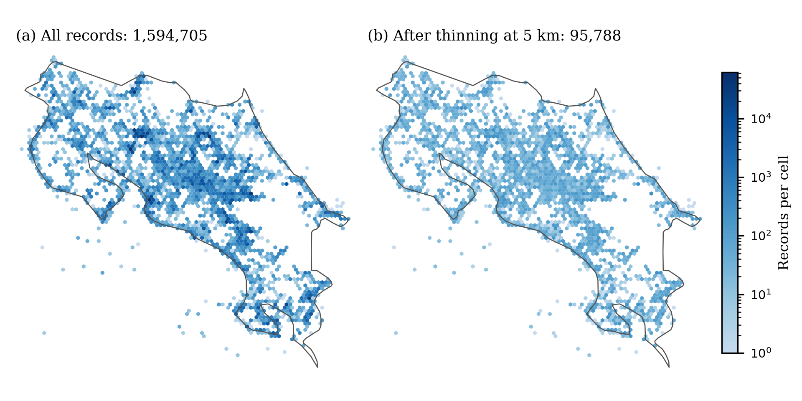

# ThinGPU

**Exact spatial thinning and sampling-effort density for species occurrence records, on the GPU or the CPU.**


<!-- DOI badge: add the Zenodo DOI after the first release -->

## Overview

Occurrence records from GBIF and similar sources gather where people sample rather than where species live, so species distribution models (SDMs) trained on them can learn sampling effort instead of habitat. Two corrections are standard:

- **Spatial thinning** keeps, for each species, only records that are at least a distance *d* apart.
- **Target-group density** counts, around every record, how many records of the whole taxon lie within *d*; it is an estimate of sampling effort for background selection or bias layers.

Both rest on the same computation: finding all records within a geodesic distance *d* of each record. ThinGPU runs that search with a GPU spatial index, so it can thin every species of a national or continental dataset in one pass and test several distances in seconds. The result is **exact**: no two kept records of a species are closer than *d*, and no discarded record could be added back.



*Bird records from Costa Rica, 2018: all 1,594,705 GBIF records (left) and the 95,788 kept after thinning every species at 5 km (right).*

## How it works

1. Coordinates are placed on the sphere in 3D. Two records are within geodesic distance *d* exactly when their straight-line distance is below the chord 2R·sin(*d*/2R), so no map projection is needed.
2. A spatial index (k-d tree by default; a linear BVH and a uniform grid are also available) finds every record's neighbours of the same species.
3. Thinning is solved as a maximal independent set. Every record gets a fixed priority, by default **fewest neighbours first**, which keeps more records than the rule of spThin and GeoThinneR. Records are then decided in parallel rounds, which return exactly the sequential greedy result (Blelloch, Fineman and Shun, 2012).
4. The CPU and GPU versions use the same priorities, so their results can be compared record by record (`thingpu selftest`).

## Requirements

| To run on | You need |
|---|---|
| CPU only | Python ≥ 3.9 with numpy, scipy and pandas (installed automatically) |
| GPU | The above, plus an NVIDIA GPU, the CUDA Toolkit ≥ 12.0 (`nvcc`), CMake ≥ 3.18 and a C++17 compiler supported by your CUDA version (e.g. gcc 8–13) |

Tested on an NVIDIA L40S with CUDA 12.4 and gcc 11.5. The CPU version is fine for single species or small datasets; the GPU pays off with many species, many distances or millions of records.

## Installation

```bash
git clone https://github.com/JoMoSa27/ThinGPU.git
cd ThinGPU
pip install .
```

To add GPU support, build the CUDA program and tell ThinGPU where it is:

```bash
cmake -S . -B build -DCMAKE_CUDA_ARCHITECTURES=89   # 89 = L40S/RTX 40; use 80 for A100, 86 for RTX 30, 70 for V100
cmake --build build -j
export THINGPU_GPU=$PWD/build/thingpu-gpu            # or copy it to a folder in your PATH
```

Check the installation. With a GPU, this also confirms that GPU and CPU give identical results:

```bash
thingpu selftest
```

## Quick start

```bash
thingpu example --out occurrences.csv                       # synthetic data to try the tool
thingpu thin occurrences.csv --distance 1 5 10 --out thinned.csv
thingpu effort occurrences.csv --distance 5 --out effort.csv
```

`thingpu thin` prints what it did:

```
24,000 records, 20,000 unique and valid, 25 species; backend: CPU
  1 km: kept 11,145 of 20,000 in 10 rounds (0.03 s)
  5 km: kept 4,682 of 20,000 in 8 rounds (0.50 s)
  10 km: kept 3,015 of 20,000 in 6 rounds (1.47 s)
```

The output keeps every input row and adds columns:

| Column | Meaning |
|---|---|
| `thingpu_valid` | coordinates usable (and within `--max-uncertainty`, if given) |
| `thingpu_repeat` | same species at the same coordinates as an earlier record; excluded from thinning |
| `kept_<d>km` | the record is kept after thinning at *d* km |
| `neighbours_<d>km` | (`effort`) records of any species within *d* km, excluding itself |

To keep only the thinned records, use `--only-kept` with a single distance.

## Using a GBIF download

Download occurrences from [gbif.org](https://www.gbif.org) in the *Simple* format and unzip it. ThinGPU reads the tab-separated file directly and finds the `decimalLongitude`, `decimalLatitude` and `species` columns by itself:

```bash
thingpu thin 0012345-260921141020460.csv --distance 5 --max-uncertainty 1000 --out thinned.tsv
```

Remember to cite the download's DOI, as GBIF requires.

## Options

| Option | Default | Description |
|---|---|---|
| `--distance`, `-d` | required | one or more thinning distances in km |
| `--out`, `-o` | required | output file; `.tsv` or `.txt` writes tab-separated |
| `--species-col` | `species`, then `scientificName` | column that defines the groups thinned independently |
| `--no-species` | off | treat all records as one species |
| `--lon-col`, `--lat-col` | GBIF names, `longitude`, `lon`, `x`… | coordinate columns, in decimal degrees |
| `--max-uncertainty` | none | drop records whose `coordinateUncertaintyInMeters` exceeds this value |
| `--rule` | `mindeg` | priority order: `mindeg` (fewest neighbours first) or `random` |
| `--seed` | 0 | breaks ties between equal priorities |
| `--backend` | `auto` | `gpu`, `cpu`, or `auto` (GPU when available) |
| `--index` | `kdtree` | GPU index: `kdtree`, `lbvh` or `grid`; the k-d tree is the most robust to clustered data |
| `--check` | off | verify the result on the CPU: no close pairs, nothing that could be added |

Repeated records (same species and coordinates to 5 decimals, about 1 m) are left out of thinning because they add no spatial information, but they are kept by `effort`, since each one is a visit.

## Choosing the thinning distance

No distance is best in general (Lamboley and Fourcade, 2024). In our tests, thinning removed the concentration of records up to the scale of the grid used to measure it, and beyond that scale only discarded records. A practical rule is to thin at the resolution of your environmental predictors or analysis grid, and to compare a few distances, which ThinGPU makes cheap. Thinning reduces redundancy but does not remove the imprint of sampling effort; combine it with a target-group background, which `thingpu effort` provides from the same search.

## Python API

```python
import numpy as np
from thingpu import thinning, gpu
from thingpu.geometry import to_xyz

xyz = to_xyz(lon, lat)                         # arrays in decimal degrees
species = np.asarray(species_ids, np.int32)    # -1 = do not thin
kept, rounds = thinning.thin(xyz, species, distance_m=5000)            # CPU
kept, rounds, info = gpu.thin(xyz, species, 5000)                      # GPU
counts = thinning.target_group_density(xyz, 5000)
```

## Running on an HPC cluster

With SLURM, request one GPU and run the same commands. For example:

```bash
#!/bin/bash
#SBATCH --job-name=thingpu
#SBATCH --gres=gpu:1                 # or the GPU partition of your cluster
#SBATCH --time=00:30:00
module load cuda                     # name depends on the cluster
export THINGPU_GPU=$HOME/ThinGPU/build/thingpu-gpu
thingpu thin occurrences.csv --distance 1 5 10 25 50 --out thinned.csv
```

## Reproducing the paper

The analyses, benchmarks and figures of the paper (GBIF downloads with DOIs, comparison with GeoThinneR, SDM pilot) are in the companion repository [Filtrado-espacial-en-GPU-de-registros-de-biodiversidad](https://github.com/JoMoSa27/Filtrado-espacial-en-GPU-de-registros-de-biodiversidad).

## References

- Aiello-Lammens, M. E., Boria, R. A., Radosavljevic, A., Vilela, B., & Anderson, R. P. (2015). spThin: an R package for spatial thinning of species occurrence records for use in ecological niche models. *Ecography*, 38(5), 541–545. <https://doi.org/10.1111/ecog.01132>
- Blelloch, G. E., Fineman, J. T., & Shun, J. (2012). Greedy sequential maximal independent set and matching are parallel on average. *Proc. 24th ACM SPAA*, 308–317. <https://doi.org/10.1145/2312005.2312058>
- Boria, R. A., Olson, L. E., Goodman, S. M., & Anderson, R. P. (2014). Spatial filtering to reduce sampling bias can improve the performance of ecological niche models. *Ecological Modelling*, 275, 73–77. <https://doi.org/10.1016/j.ecolmodel.2013.12.012>
- Burtscher, M., Devale, S., Azimi, S., Jaiganesh, J., & Powers, E. (2018). A high-quality and fast maximal independent set implementation for GPUs. *ACM Transactions on Parallel Computing*, 5(2), 8. <https://doi.org/10.1145/3291525>
- GBIF.org (25 September 2026). GBIF occurrence downloads for Costa Rica: Aves 2018 <https://doi.org/10.15468/dl.xdw99k>, Insecta 2018 <https://doi.org/10.15468/dl.e5pzwg>, Plantae <https://doi.org/10.15468/dl.mbz7g2>, Amphibia <https://doi.org/10.15468/dl.4awycg>.
- GBIF.org (3 November 2026). GBIF occurrence download: *Turdus grayi*. <https://doi.org/10.15468/dl.js3buy>
- Hughes, A. C., et al. (2021). Sampling biases shape our view of the natural world. *Ecography*, 44(9), 1259–1269. <https://doi.org/10.1111/ecog.05926>
- Lamboley, Q., & Fourcade, Y. (2024). No optimal spatial filtering distance for mitigating sampling bias in ecological niche models. *Journal of Biogeography*, 51(9), 1783–1794. <https://doi.org/10.1111/jbi.14854>
- Mestre-Tomás, J. (2026). GeoThinneR: an R package for efficient spatial thinning of species occurrences and point data. *The R Journal*, 18(1), 299–314. <https://doi.org/10.32614/RJ-2026-006>
- Phillips, S. J., et al. (2009). Sample selection bias and presence-only distribution models: implications for background and pseudo-absence data. *Ecological Applications*, 19(1), 181–197. <https://doi.org/10.1890/07-2153.1>
- Phillips, S. J., Anderson, R. P., Dudík, M., Schapire, R. E., & Blair, M. E. (2017). Opening the black box: an open-source release of Maxent. *Ecography*, 40(7), 887–893. <https://doi.org/10.1111/ecog.03049>
- ten Caten, C., & Dallas, T. (2023). Thinning occurrence points does not improve species distribution model performance. *Ecosphere*, 14(12), e4703. <https://doi.org/10.1002/ecs2.4703>

## Citation

If you use ThinGPU, please cite:

> J. Morera Salas and C. Asch Burgos, "ThinGPU: a massively parallel tool to mitigate sampling bias in Costa Rica's national biodiversity records," *Tecnología en Marcha*, 2026 (IEEE BIP 2026, in press).

See also `CITATION.cff`.

## License

ThinGPU is source-available under the [PolyForm Strict License 1.0.0](LICENSE): you may use it for any noncommercial purpose, including research and teaching at universities and public institutions, but you may not modify it or redistribute it. For other uses, contact the authors.

The spatial indexes in `third_party/spatial` come from the authors' structures library (commit e02d229) and are covered by the same license.

## Acknowledgments

This research was partially supported by a machine allocation on Kabré supercomputer at the Costa Rica National High Technology Center.
